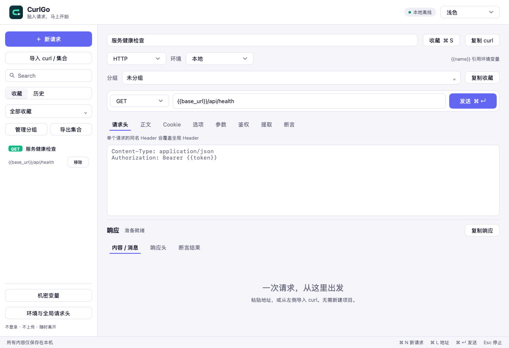

# CurlGo

[简体中文](README.md) | English


**Your API tool, under your control.**

A lightweight local API client with a native MyGo 0.9.0 interface. Open it and start sending; no account and no project to create first, and requests and workspaces stay on your machine. HTTP, SSE and WebSocket, with an optional CLI and agent skill.

[Download the latest release](https://github.com/echoVic/curlgo/releases/latest) · [Changelog](CHANGELOG.md) · [MIT license](LICENSE)



## Download

- **macOS Apple silicon**: download the DMG from [Releases](https://github.com/echoVic/curlgo/releases/latest) and drag CurlGo into Applications. It is signed with a Developer ID and notarized by Apple, and checksums ship with each release.
- **Windows x64 / ARM64**: an installer or a portable ZIP. It isn't signed yet, so SmartScreen may warn.
- **Linux and Intel Macs**: build from source.

## Features

- **Requests**: method, URL, editable query parameters, request headers, raw bodies and multipart file uploads; response headers, timing, cancel and timeout, JSON / XML formatting, HTML / CSS highlighting.
- **HTTP, SSE and WebSocket**: SSE over GET or POST with multi-line data, event / id and stop at any time; WebSocket with ws / wss, handshake headers, two-way text messages and binary messages shown as base64.
- **Cookies and environments**: a shared, persistent GUI Cookie jar that follows domain, path, Secure, expiry and public-suffix rules; multiple environments, global headers, and `{{name}}` variables in URLs, headers and bodies.
- **Secrets**: per-environment secret variables, with the master key in the macOS Keychain and the values encrypted in their own file; reference them as `{{secret.token}}` and curl and collection exports keep the reference.
- **Auth and assertions**: Bearer, Basic and API Key (header or query); assertions on status, headers, JSON fields and body return a result per rule; extracted response variables are written into the environment atomically once the whole response is 2xx and assertions pass.
- **Import and favourites**: paste curl or import Postman v2.1 / Bruno collections, preview first, then add to favourites; grouped favourites, the last 100 requests of history and draft recovery. Collection scripts never run.
- **Interface**: light and dark themes, keyboard operation, natively resizable request and response panes, and configurable shortcuts described in [Keyboard shortcuts](docs/keyboard-shortcuts.md).

## CLI and agents

The standalone CLI doesn't start the GUI; help, dry runs and `run` all print `schemaVersion: 1` JSON:

```sh
CGO_ENABLED=0 go build -o /tmp/curlgo-api-test ./cmd/curlgo
/tmp/curlgo-api-test run --request request.json          # or --curl imported.curl
/tmp/curlgo-api-test run --request request.json --dry-run   # local preflight, nothing sent
/tmp/curlgo-api-test skill                              # the guide bundled with this CLI
```

The agent skill entry point is [skills/api-test/](skills/api-test/SKILL.md); installation is described in [the optional skill notes](docs/agent-skill.md). `curlgo skill` prints Markdown and `curlgo help` prints JSON help, and neither touches the target API.

## Data and security

- GUI data lives in `~/Library/Application Support/QingzhouAPI/` on macOS and in Go's user config directory elsewhere; `workspace.json` holds drafts, favourites, history, environments and cookies, and `workspace.json.bak` keeps the previous valid copy.
- Ordinary workspace data is local plain text (directory 0700, files 0600); secret values are encrypted with AES-256-GCM in `secret-vault.json`, with the master key in the macOS Keychain.
- TLS certificates are verified and connections go direct; `HTTP_PROXY` / `HTTPS_PROXY` are not read, and the CLI takes CA, cookie and proxy settings explicitly.
- No telemetry and no cloud sync; history does not keep response bodies.

## Development

You need Go 1.27.3; cgo isn't used.

```sh
CGO_ENABLED=0 go run .                                    # desktop app
CGO_ENABLED=0 go test -p=2 -parallel=2 ./...
go vet ./... && go tool mygo vet .
go tool mygo build -platform darwin/arm64 -sign - -skip-notarize -skip-dmg
```

When changing the CLI, also run `go vet ./cmd/curlgo ./internal/...`, `go test ./cmd/curlgo ./internal/...` and `python3 scripts/test_api_skill.py --binary <built CLI>`. CI runs the Go checks on macOS and Windows and the local CLI scenarios on Linux.

## Current boundaries

- Raw bodies and single stream messages are capped at 1 MiB; HTTP responses capture up to 4 MiB and say so when truncated; SSE does not reconnect automatically yet.
- No OAuth flow, client-certificate panel, team collaboration, plugins, GraphQL pane, gRPC or script execution.
- The Mac is the primary platform; Linux, Intel Macs and native Windows still need more validation.

## Documents

[Keyboard shortcuts](docs/keyboard-shortcuts.md) · [Declarative assertions](docs/assertions.md) · [Response extraction](docs/response-extraction.md) · [Project secrets](docs/project-secrets.md) · [Optional agent skill](docs/agent-skill.md) · [Changelog](CHANGELOG.md)

## License

[MIT](LICENSE). Dependency licenses ship with the app.
