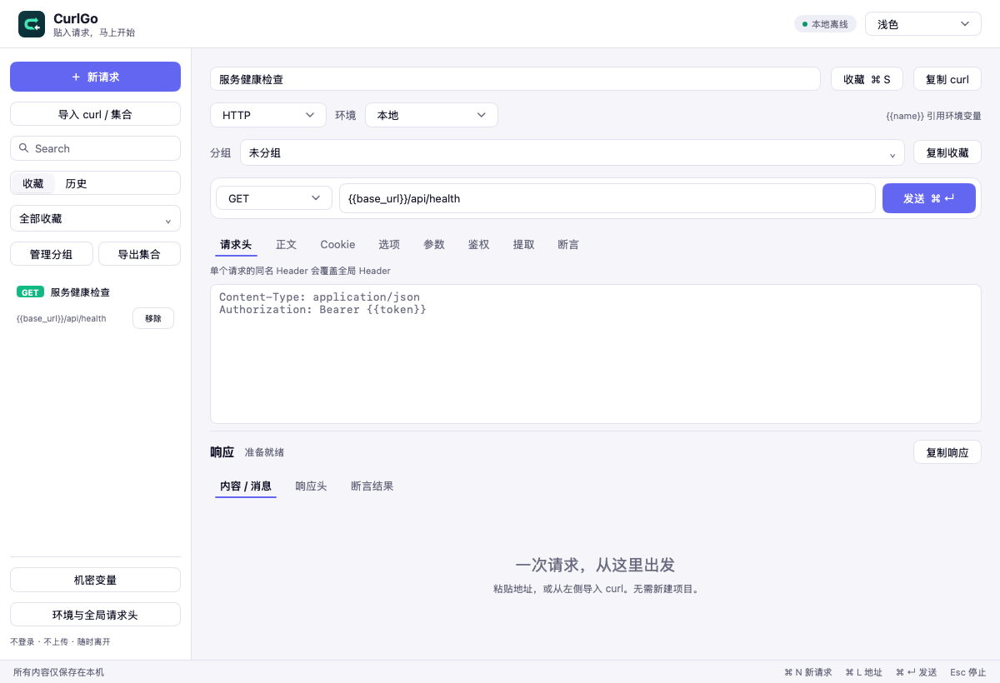

# CurlGo

简体中文 | [English](README.en.md)


**你的 API 工具，由你做主。**

轻量本地 API 客户端，基于 MyGo 0.9.0 原生 UI。打开即用，无需账户或先建项目，请求数据与工作区保存在本机。HTTP、SSE、WebSocket，以及可选的 CLI 与 Agent Skill。

[下载最新版](https://github.com/echoVic/curlgo/releases/latest) · [版本记录](CHANGELOG.md) · [MIT 许可证](LICENSE)



## 下载

- **macOS Apple Silicon**：从 [Releases](https://github.com/echoVic/curlgo/releases/latest) 下载 DMG，拖进「应用程序」。已用 Developer ID 签名并经 Apple 公证，校验和随 Release 提供。
- **Windows x64 / ARM64**：安装程序或免安装 ZIP，当前未签名，SmartScreen 可能提示。
- **Linux 与 Intel Mac**：目前提供源码。

## 功能

- **请求**：方法、URL、可编辑查询参数、请求头、原始正文与 multipart 文件上传；响应头、耗时、取消与超时，JSON / XML 格式化，HTML / CSS 语法高亮。
- **HTTP、SSE、WebSocket**：SSE 支持 GET / POST、多行 data、event / id 和随时停止；WebSocket 支持 ws / wss、握手请求头、文本双向消息和二进制消息的 base64 展示。
- **Cookie 与环境**：GUI 共享并持久化 Cookie Jar，遵循域名、路径、Secure、过期和公共后缀规则；多个环境、全局请求头，URL / Header / 正文用 `{{name}}` 引用变量。
- **机密**：按环境保存机密变量，主密钥在 macOS 钥匙串，值单独加密保存在文件里；`{{secret.token}}` 引用，复制 curl 和集合时保留引用。
- **鉴权与断言**：Bearer、Basic、API Key（Header / Query）；状态码、响应头、JSON 字段和正文断言逐条给结果；响应变量提取在完整 2xx 且断言通过后原子写入环境。
- **导入与收藏**：粘贴 curl 或导入 Postman v2.1 / Bruno 集合，先预览再加入收藏；收藏分组、最近 100 条历史、上次草稿恢复；集合脚本不会执行。
- **界面**：浅色 / 深色主题、键盘操作、原生可调整的请求与响应分区；快捷键可自定义，见[键盘快捷键](docs/keyboard-shortcuts.md)。

## CLI 与 Agent

独立 CLI 不启动 GUI，帮助、预检与 `run` 输出 `schemaVersion: 1` 的 JSON：

```sh
CGO_ENABLED=0 go build -o /tmp/curlgo-api-test ./cmd/curlgo
/tmp/curlgo-api-test run --request request.json          # 或 --curl imported.curl
/tmp/curlgo-api-test run --request request.json --dry-run   # 本地预检，不发送请求
/tmp/curlgo-api-test skill                              # 当前 CLI 自带的主指南
```

Agent Skill 入口在 [skills/api-test/](skills/api-test/SKILL.md)，安装说明见[可选技能说明](docs/agent-skill.md)。`curlgo skill` 输出 Markdown，`curlgo help` 输出 JSON 帮助，都不访问目标接口。

## 数据与安全

- GUI 数据在 macOS 的 `~/Library/Application Support/QingzhouAPI/`，其他平台用 Go 的用户配置目录；`workspace.json` 保存草稿、收藏、历史、环境和 Cookie，`workspace.json.bak` 保留上一份有效内容。
- 普通工作区数据是本地明文（目录 0700、文件 0600）；机密值在 `secret-vault.json` 中用 AES-256-GCM 加密，主密钥在 macOS 钥匙串。
- 默认校验 TLS 证书、直连目标，不读取 `HTTP_PROXY` / `HTTPS_PROXY`；CLI 的 CA、Cookie、代理都需显式提供。
- 没有遥测或云同步；历史不保存响应正文。

## 开发

需要 Go 1.27.3，不使用 cgo。

```sh
CGO_ENABLED=0 go run .                                    # 桌面版
CGO_ENABLED=0 go test -p=2 -parallel=2 ./...
go vet ./... && go tool mygo vet .
go tool mygo build -platform darwin/arm64 -sign - -skip-notarize -skip-dmg
```

改动 CLI 时额外跑 `go vet ./cmd/curlgo ./internal/...`、`go test ./cmd/curlgo ./internal/...`，以及 `python3 scripts/test_api_skill.py --binary <构建出的 CLI>`。CI 在 macOS 和 Windows 上跑 Go 检查，在 Linux 上跑独立 CLI 的本地场景。

## 当前边界

- 原始正文和单条流消息最多 1 MiB；HTTP 响应最多捕获 4 MiB，超出提示截断；SSE 暂时不自动重连。
- 暂无 OAuth 授权流程、客户端证书面板、团队协作、插件、GraphQL 面板、gRPC 或脚本执行。
- Mac 是首要平台；Linux、Intel Mac 和 Windows 原生运行仍需进一步验证。

## 文档

[键盘快捷键](docs/keyboard-shortcuts.md) · [声明式断言](docs/assertions.md) · [响应变量提取](docs/response-extraction.md) · [机密变量](docs/project-secrets.md) · [可选 Agent 技能](docs/agent-skill.md) · [CHANGELOG](CHANGELOG.md)

## 许可

[MIT](LICENSE)。依赖许可随应用包附带。
