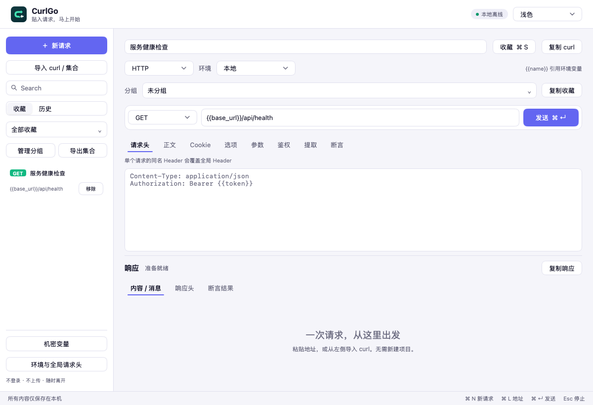

# CurlGo


**你的 API 工具，由你做主。**

轻量本地 API 客户端，基于 MyGo 0.7.1 原生 UI。打开即用，无需账户或先建项目，请求数据与工作区保存在本机。更新检查会访问 GitHub，可在设置中关闭。HTTP、SSE、WebSocket，以及可选的 CLI 与 Agent Skill。

[下载 v0.1.1 · macOS Apple Silicon](https://github.com/echoVic/curlgo/releases/tag/v0.1.1) · [版本记录](CHANGELOG.md) · [MIT 许可证](LICENSE)



[Remotion 产品视频源码与渲染方法](marketing/video/README.md)

## 下载与开始使用

首个安装包面向 macOS Apple Silicon（M 系列芯片）。从 Release 下载 DMG，打开后将 CurlGo 拖入 Applications。安装包使用 Developer ID 签名并经过 Apple 公证，校验和随 Release 提供。其他平台当前提供源码。

打开后粘贴 curl，或点击「导入 curl / 集合」导入 Postman v2.1 / Bruno 集合；先查看预览，再加入收藏。集合中的脚本不会执行，依赖脚本的工作流需要另行迁移。

桌面端不自动安装 agent 技能、插件或 MCP，不修改 Codex、Claude Code、Copilot 配置。技能接入由用户主动选择。

「设置」页显示当前版本，支持主动检查更新和开关后台自动检查。默认每四小时检查一次，自动下载默认关闭；新版本通过签名校验后由你选择安装与重启。0.1.0 没有更新器，需要手动安装一次 0.1.1。

## 可以做什么

- HTTP / HTTPS 请求：方法、URL、可编辑查询参数、请求头、原始正文与 multipart 文件上传；响应头、耗时、取消与超时，JSON / XML 响应格式化，HTML / CSS 语法高亮。
- SSE：支持 GET / POST，持续接收事件、多行 data、event / id，随时停止。
- WebSocket：ws / wss、握手请求头、文本双向消息、二进制消息的 base64 展示。
- Cookie：GUI 共享并持久化 Cookie Jar，重启后恢复，遵循域名、路径、Secure、过期及公共后缀规则；查看当前地址适用值或清空。CLI 跨调用共享需显式指定 Cookie 文件。
- 自定义 CA，HTTP / HTTPS / SOCKS5 代理与绕过列表；默认校验证书、直连，不自动读取系统代理。
- 多个环境、全局请求头，URL / Header / 正文使用 `{{name}}` 引用变量；请求同名 Header 覆盖全局配置。
- 按环境管理机密变量：macOS 钥匙串保存主密钥，独立文件加密保存值；`{{secret.token}}` 引用，复制 curl 和集合保留引用，CLI 使用显式 `--secrets-file`。
- 鉴权面板：Bearer、Basic 和 API Key（Header / Query）；声明式断言：状态码、响应头、JSON 字段及正文，每条规则均有结果；响应变量提取在完整 2xx 且断言通过后原子写入环境，供后续请求引用。
- curl 文本导入与复制导出，收藏请求，最近 100 条历史恢复，上次草稿自动恢复。
- 收藏分组；Postman v2.1、Bruno 和原生 CurlGo 集合导入预览，CurlGo / Postman 集合导出；不执行集合脚本。
- 浅色 / 深色主题，键盘操作，原生可调整的请求与响应分区。
- 可自定义的键盘快捷键：新请求、收藏、发送、聚焦地址栏、停止与打开设置；提示按平台显示 ⌘ / Ctrl，地址栏内也可直接发送，配置随工作区保存在本地（见[键盘快捷键](docs/keyboard-shortcuts.md)）。

## Agent 与 CLI

CLI 帮助、预检与 `curlgo run` 不启动 GUI，向 stdout 输出一个 `schemaVersion: 1` JSON 文档；普通 `run` 每次执行一个 HTTP / HTTPS 请求。先用 `command -v curlgo` 检查可执行文件；不存在时在仓库根目录构建独立 CLI，以下命令的 `curlgo` 均替换为 `/tmp/curlgo-api-test`，不要切换到第二个 HTTP 客户端：

```sh
CGO_ENABLED=0 go build -o /tmp/curlgo-api-test ./cmd/curlgo
```

[下载独立 CLI v0.1.0](https://github.com/echoVic/curlgo/releases/tag/cli-v0.1.0) · [CLI 与指南版本记录](internal/cli/CHANGELOG.md)

### 项目 Agent 能力

通用 Agent Skill 入口位于 [skills/api-test/](skills/api-test/SKILL.md)。它先通过 `curlgo help` 确认支持，再引导 Agent 执行 `curlgo skill`；完整指南、工作流和参考资料由 CLI 内置，随可执行文件一起升级，避免技能文件与实际能力错配。升级或切换 CLI 后应重新读取指南。桌面客户端独立版本、独立升级；CLI 与完整指南的版本在 `internal/cli/VERSION`，入口 skill 的版本只记录引导方式变化。

```sh
curlgo skill                  # 当前 CLI 自带的主指南
curlgo skill workflows        # 请求构造、登录与业务链路示例
curlgo skill cli-reference    # 当前版本的字段与选项说明
```

`skill` 输出 Markdown，最后一行为 `[curlgo:skill] end of guide`；它不启动 GUI、不读取 stdin、不访问目标接口或写入工作区。其他 CLI 帮助、预检和请求命令继续输出 JSON。指南源码位于 [internal/cli/guide/](internal/cli/guide/api-test.md)；维护断言、响应提取和机密变量时，同步更新 `docs/` 与这里的对应参考文档。
以下命令由用户主动执行第三方 skills CLI。它会添加技能文件或链接；先在交互界面确认目标 agent、安装范围与路径，再完成安装。桌面端不会执行这些命令，也不会自动注册启动 hook 或批准信任。

在仓库根目录可安装到 Claude Code 与 Codex：

```sh
npx skills add ./skills/api-test -a claude-code -a codex
```

也可直接从公开 GitHub 仓库安装：

```sh
npx skills add echoVic/curlgo --skill api-test -a claude-code -a codex
```

技能安装只添加稳定入口与安装说明，不安装或升级 CLI。运行需要支持 `curlgo skill` 的可执行文件，或 Go 1.27.3 与 CurlGo 源码。源码构建命令须在 CurlGo 仓库根目录执行。独立 CLI 无参数时显示帮助；桌面可执行文件无参数仍启动 GUI。

安装、查看安装范围和移除方法见[可选技能说明](docs/agent-skill.md)。卸载桌面应用不会移除你另外安装的技能。

运行时指南按任务选择参考主题；`curlgo skill workflows`（[源码](internal/cli/guide/workflows.md)）提供 JSON 正文序列化、查询编码、私有令牌串联、文件响应读取，以及创建→完成→查询的串行示例。链路显式传递返回 ID、保留私有步骤证据，并以最终对象与状态判断整体验收。给定 diff 或 commit 时，技能按变更选择相关接口和断言，简述后执行，无需单独编写测试计划。`request.body` 是字符串，变量替换不会做 JSON 转义；CLI 查询参数以 `request.url` 为准，`request.queryParams` 只用于编辑器元数据。

维护者可在仓库根目录复跑真实 CLI 场景。脚本使用 Python 标准库启动临时本地 HTTP 服务，验证登录、Cookie、上传字节、大响应、失败诊断，并直接执行技能文档中的 Python 例子。业务链路覆盖成功、前置业务失败后不再发送后续请求，以及全部返回 2xx 但最终状态、对象 ID 或业务字段不符的情况；本地 fixture 不代表真实业务系统验收。测试临时文件自动清理；TLS 场景需要系统 `openssl`，缺失时明确跳过：

```sh
CGO_ENABLED=0 go build -o /tmp/curlgo-api-test ./cmd/curlgo
python3 scripts/test_api_skill.py --binary /tmp/curlgo-api-test
```

加 `--public` 可额外执行 JSONPlaceholder 与 GitHub 的匿名 GET；公网失败或限流会报告实际状态并让脚本退出非零，不计为通过。

### JSON 帮助

根命令与 `run` 帮助均使用 schema v1 JSON，不是请求结果，也不需要请求输入：

```sh
curlgo help
curlgo help run
curlgo -h
curlgo --help
curlgo run --help
curlgo run -h
```

成功时返回 `schemaVersion: 1`、`ok: true` 与 `help`，没有 `result`；`help` 提供 `usage`、`options`、`protocols`、`urlSchemes`、`authentication`、`limits` 与 `exitCodes`。帮助不发送请求或读取请求、CA、Cookie、机密输入。无参数的 `curlgo` 仍启动 GUI，不是帮助命令。

### 请求输入

本地服务已在 8080 端口运行时，`request.json` 最小示例：

```json
{
  "schemaVersion": 1,
  "request": {
    "method": "GET",
    "url": "http://127.0.0.1:8080/health",
    "followRedirects": true,
    "timeoutSeconds": 30
  }
}
```

`imported.curl` 可包含 `curl --location 'http://127.0.0.1:8080/health'`。选择文件或 stdin 输入，`--request` 与 `--curl` 互斥：

```sh
curlgo run --request request.json
curlgo run --request - <request.json
curlgo run --curl imported.curl
curlgo run --curl - <imported.curl
```

输入与输出均使用 schema v1。JSON 缺省为 GET / HTTP、30 秒超时、跟随重定向；显式 `false` 保留，超时 0 拒绝。curl 未指定 `-L` 时不跟随重定向。

### 离线预检

在发送前用相同输入与配置加上 `--dry-run`：

```sh
curlgo run --request request.json --dry-run
curlgo run --request - --dry-run <request.json
curlgo run --curl imported.curl --dry-run
curlgo run --curl - --dry-run <imported.curl
```

预检解析输入、展开变量并校验请求与鉴权、断言、CA、Cookie、代理配置；可读取本地输入、CA 与已有 Cookie 文件，multipart 准备会检查普通文件、打开并关闭文件，但不读取文件内容、不上传。不执行 HTTP、DNS、TLS 握手或代理连接，不创建响应正文文件、目录或 Cookie 文件，不保存或更新状态、不运行响应断言或变量提取，也没有 `result`、响应正文或 `timing`。成功只表示本地准备通过，不代表目标可达、TLS 证书链可信、登录或业务成功。

最小 GET 示例的预检输出包含八个 `validation` 字段；`bodyMode: ""` 表示原始正文模式，计数是准备后的请求头与表单项数，不是响应信息：

```json
{
  "schemaVersion": 1,
  "ok": true,
  "validation": {
    "dryRun": true,
    "method": "GET",
    "protocol": "HTTP",
    "bodyMode": "",
    "headerCount": 0,
    "formPartCount": 0,
    "timeoutSeconds": 30,
    "followRedirects": true
  }
}
```

显式 `--out-dir` 与 `--cookie-jar` 的父目录（即使 jar 不存在）必须已存在且为目录。预检只检查存在与目录类型，不检查写权限或剩余空间，不执行 mkdir 或保存；该路径检查失败为 `OUTPUT_ERROR` / 退出 3。普通执行仍可能在写文件或保存 Cookie 时失败。

### 成功与诊断

| 模式 | 退出码 0 / `ok: true` 的含义 |
|---|---|
| 帮助 | 帮助 JSON 输出成功，不是 API 检查 |
| `--dry-run` | 本地准备与预检 JSON 输出成功，没有发送请求 |
| 普通 `run` | 响应捕获、已配置的断言、适用的提取及输出成功，仅验证所列规则；无断言时 HTTP 401 / 404 / 500 也可退出 0，须检查 `result.statusCode` 与正文 |

机器分类使用稳定的退出码与 `error.code`，不要匹配 `error.message`；消息只提供安全提示，不回显原始凭证、输入或底层错误。退出码 1 为用法、输入、配置或请求构造错误（`INVALID_USAGE`、`INVALID_INPUT`、`INVALID_CURL`、`UNRESOLVED_VARIABLE`、`MISSING_SECRET`、`INVALID_SECRETS`、`INVALID_REQUEST`、`REQUEST_BUILD_ERROR`）；2 为执行或提取失败（`CONNECT_ERROR`、`REDIRECT_ERROR`、`TLS_ERROR`、`TIMEOUT`、`CANCELED`、`BODY_READ_ERROR`、`EXTRACTION_ERROR`）；3 为输出路径、正文输出或 Cookie 保存失败（`OUTPUT_ERROR`）；4 为响应断言失败（`ASSERTION_FAILED`）。stdout 本身写入失败也退出 3，此时 JSON 可能不完整，stderr 使用固定提示 `CurlGo: 无法写入结果 JSON`。

### 普通执行输出

小文本原样放在 `result.body.text`；二进制或超过默认 262144 字节内联阈值的正文保存到 `body.path`，须读取该文件。`--inline-body-bytes` 范围 0–4194304，0 让所有非空正文写文件；捕获最多 4 MiB，`truncated` 为真时不能声称响应完整或直接解析不完整 JSON。文件 0600，默认临时目录 0700，保留供调用方读取与清理；`--out-dir` 须为已有目录，不应删除用户目录或无关文件。`timing` 为毫秒，DNS / 连接 / TLS 累计已完成阶段，TTFB 从执行开始到最后响应首字节，total 到捕获结束；阶段可重叠，不可相加，正文 bytes 为自动解压后的应用字节而非网络流量。

CLI 不加载 GUI 工作区。变量来自 JSON `settings.environments` / `environment`，而非 OS 环境；CA、Cookie、代理分别通过 `--ca-file`、`--cookie-jar`、`--proxy` 显式提供，不读取 `HTTP_PROXY` / `HTTPS_PROXY` / `NO_PROXY`。凭证使用 0600 私有文件或 stdin，不放命令行参数；curl 只解析文本，不执行 shell 或隐式 `@file` 读取。响应头、正文和 URL 仍可能含秘密。安全输入、授权 multipart、串行登录链、错误与清理规则见项目技能 [api-test](skills/api-test/SKILL.md)；v1 不含脚本断言、集合运行器或无界面 SSE / WebSocket。

### 结构化鉴权

在 JSON `request.auth` 中选择一种模式；省略 `auth` 或 `mode` 时使用手工请求头，不生成鉴权。下表各对象用于替换 `request.auth`，不是 CLI 凭证参数：

| 模式 | `request.auth` JSON |
|---|---|
| Bearer | `{"mode":"bearer","token":"{{token}}"}` |
| Basic | `{"mode":"basic","username":"{{username}}","password":"{{password}}"}` |
| API Key Header | `{"mode":"apikey","location":"header","key":"{{api_key_name}}","value":"{{api_key}}"}` |
| API Key Query | `{"mode":"apikey","location":"query","key":"api_key","value":"{{api_key}}"}` |

API Key 省略 `location` 时默认 Header。鉴权变量同样从所选 JSON 环境展开；Bearer / Basic 生成 `Authorization`，Header API Key 生成指定请求头，均覆盖手工与全局配置中的同名 Header（大小写不敏感）。Query API Key 替换 URL 中同名参数，重复同名项合为一个，其他参数保留。预检校验鉴权设置及变量，但不会验证凭证是否被服务器接受。

以下完整示例只含文档演示值，不是真实凭证；三个模式所需变量都放在所选环境中。真实值应经结构化序列化写入 0700 私有目录中的 0600 输入文件或通过 stdin 提供，不使用 CLI 凭证参数：

```json
{
  "schemaVersion": 1,
  "request": {
    "method": "GET",
    "url": "{{base_url}}/health",
    "followRedirects": true,
    "timeoutSeconds": 30,
    "auth": {"mode": "bearer", "token": "{{token}}"}
  },
  "settings": {
    "environment": "local",
    "environments": {
      "local": {
        "base_url": "http://127.0.0.1:8080",
        "token": "documentation-only-token",
        "username": "documentation-user",
        "password": "documentation-only-password",
        "api_key_name": "X-API-Key",
        "api_key": "documentation-only-key"
      }
    }
  }
}
```

将该输入作为 `auth-request.json` 时，先运行 `curlgo run --request auth-request.json --dry-run`；确认目标与请求获授权后，再去掉 `--dry-run` 发送。Query 凭证会出现在实际 URL 中，普通执行的 `result.url` 仍需私密捕获与脱敏。

真实凭证也可与请求分开：将引用改为 `{{secret.token}}`，在 0600 私有 `secrets.json` 中保存 `{"schemaVersion":1,"variables":{"token":"…"}}`，使用 `curlgo run --request auth-request.json --secrets-file secrets.json --dry-run` 预检，再按授权发送。CLI 不读取桌面钥匙串，普通环境中的 `secret.*` 不能替代机密值。格式、锁定、导出和恢复规则见[机密变量](docs/project-secrets.md)。

## 操作

直接输入完整地址发送，或点「导入 curl / 集合」；集合先预览再加入收藏，查询参数在「参数」页编辑。环境、全局请求头、CA 与代理在左下角配置，环境值使用 JSON 字符串对象。Cookie 收到 `Set-Cookie` 后自动保存，重启后恢复，可在 Cookie 页清空。收藏与历史可在左侧切换，收藏支持分组与集合导出。

集合导出的「包含环境与全局请求头」会将全局 Header 合入各请求。全局与请求 Header 名称含变量且可能形成覆盖关系时，导出会拒绝，避免导入后改变发送内容；可使用固定 Header 名称或取消该选项。Header 值中的变量仍保留。

在「提取」页配置变量名及 `/data/access_token` 等路径，成功后可在下一条请求的鉴权中引用 `{{token}}`。规则、CLI 的 `result.extractedVariables` 契约及集合兼容性见[响应变量提取](docs/response-extraction.md)。

在「断言」页配置状态码、响应头、JSON 字段或正文规则，在「断言结果」页查看逐条结果，也可编辑规则后验证当前响应。失败会保留响应并阻止变量提取；CLI 返回完整报告及退出码 4。JSON 字面量格式、结果代码与用例见[声明式断言](docs/assertions.md)。

| 快捷键 | 功能 |
|---|---|
| ⌘ N | 新请求 |
| ⌘ L | 聚焦地址 |
| ⌘ Enter | 发送 / 停止 |
| ⌘ S | 收藏 / 更新收藏 |
| Esc | 停止连接 |

## 本地存储

GUI 的 macOS 数据保存在 `~/Library/Application Support/QingzhouAPI/`；其他平台使用 Go 的用户配置目录。CurlGo 保留初版数据目录名称，已有草稿、收藏与历史可继续读取。`workspace.json` 保存草稿、收藏与分组、历史、环境配置和 Cookie；`workspace.json.bak` 保留上一份有效内容。后台合并保存、同步文件、原子替换，关窗前完成保存。损坏原件会保留，并显示恢复提示；无法恢复时进入临时会话，避免覆盖原件。

普通工作区数据为本地明文，目录权限 0700、文件权限 0600；机密值在独立的 `secret-vault.json` 中使用 AES-256-GCM 加密，主密钥在 macOS 登录钥匙串。已有字面凭证和普通环境值不自动迁移。分享或提交数据文件前请检查请求凭证与环境值。历史不保存响应正文。客户端无遥测、自动更新或云同步。

## 当前边界

- 默认校验 TLS 证书，直连目标，不读取系统代理；暂无 OAuth 授权流程或客户端证书面板。
- 原始请求正文及单条流事件 / WebSocket 消息最多 1 MiB；multipart 文件流式上传，不受原始正文大小限制。HTTP 响应最多捕获 4 MiB，超出提示截断。流消息保留最近 256 KiB。
- HTTP 超时限制整次请求；SSE / WebSocket 超时限制连接建立阶段。SSE 首版不自动重连，避免重复提交 POST。
- curl 支持常用 `--request`、`--header`、`--data`、`--data-raw`、`--data-binary`、`--json`、`--user`、`--cookie`、`--oauth2-bearer`、`--url`、`--location`、`--head`、`--max-time` 和文本 `--form-string`。不执行命令、不展开系统变量、不读隐式 `@file`；`-F` / `--form`、`--data-urlencode` 和未知参数明确拒绝。上传文件需在 GUI 选择，或使用获授权的 CLI JSON multipart 绝对路径。
- 不包括团队协作、插件、GraphQL 专用面板、gRPC 或脚本执行。
- Mac 为首要平台。首版提供 macOS Apple Silicon 安装包。冷启动、长期资源表现、干净用户账户安装、升级和其他平台的原生运行仍需进一步验证。

## 开发

需要 Go 1.27.3，MyGo 不依赖 cgo。网络执行与持久化逻辑在 `internal/core`，原生交互状态在 `app.go`，视图在 `view.go`。

```sh
CGO_ENABLED=0 go run .
CGO_ENABLED=0 go test -p=2 -parallel=2 ./...
go tool mygo vet .
go tool mygo build -platform darwin/arm64 -sign - -skip-notarize -skip-dmg
```

上述打包命令使用临时签名，适合本机开发。分发构建使用 `mygo.json` 中的签名身份与公证 profile 引用，构建机器需要自行配置对应证书和钥匙串凭据。仓库不包含私钥或公证凭据。

开发用的原生渲染可通过 `-render <file.png>` 和可选 `-dark` 参数生成，不读取用户数据、不发送网络请求。

## 依赖

MyGo 负责原生 UI，Go 标准库负责 HTTP 与文件持久化，coder/websocket 处理 WebSocket 协议，x/net/publicsuffix 支持 Cookie 公共后缀校验。依赖许可随应用包附带。
